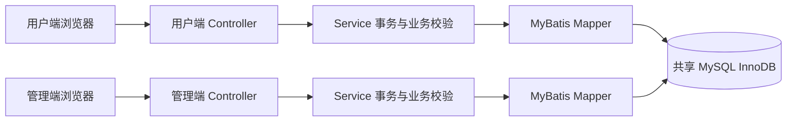

# CSUCampusCraft 校园文创商城实验报告

项目负责人：高宇弘。项目实现与资料整理使用 AI 辅助。本轮 STEP13 由高宇弘授权 Codex 执行自动验收，报告由 AI 根据实际记录整理，提交前需本人核对。2026-11-15 已有本人抽验签署只对应原七项确认，本报告不把本轮自动动作写成新增真人执行或组员签署。组员互评未实施。

## 项目范围与本轮结论

我们把课程宠物商店题材改为中南大学校园文创商城，采用真实校园地标与院系分类，首版突出毕业专区和成品礼盒。商品以独立 SKU 管理；礼盒扣自身库存，不拆分其中单品。项目采用两个独立 Spring Boot 工程，共用 MySQL，分别承载顾客选购交易和管理端商品、履约与顾客管理。

本轮最终受测提交为 `d577179e4468354552d3f5f48d624a4296ee3cfb`。39 项 P0（TST-01–35、TST-37–40）在该版本的分组自动验收中通过；TST-36 确认收货为 P1，未选做。各有效组使用相同源码、两端JAR及199项运行输入，父结果逐格记录来源，不要求或伪称某一原叶完整通过全部39项。初始化、同库、共享图片、结构空库、保留 ADMIN 的空业务及重启技术子项也已通过。M0原INIT-03双根页五主题标准保留历史身份；当前管理端根页需登录并显示A02，不以现行A02声称重现该历史页面。八项真实 HTTP 并发、五项隔离库触发器故障注入结果见后文与原始证据。M3 分组自动验收通过；该结论不替代尚未开展的组员互评。

真实支付、物流、退款售后、上传、对象存储、新用户注册、管理员账号管理、REST 接口和 P1 确认收货未实现；性能压测、生产部署和生产安全审计未验证。

## 架构与双端边界

用户端为 `csucampuscraft-user`，提供公开主题目录、商品详情、登录、持久购物车、确认、本人订单及教学模拟支付与取消。管理端为 `csucampuscraft-admin`，提供分类商品、增量补货、相册、全站订单和模拟发货、普通顾客启停及五项真实统计。两端从同一库读取已提交数据，不共享浏览器会话。

Controller 负责参数绑定、页面模型及 SSR 结果；成功写操作以 303 指向可读页。Service 承担身份复验、状态机、金额和归属校验、事务边界及行锁顺序。Mapper 只执行绑定参数的查询和条件写入，数据库以唯一键、外键、CHECK 和 InnoDB 事务形成最后约束。Thymeleaf 以转义文本展示商品设计说明、用户名和错误反馈。

用户端 Cookie 名为 `CSUCAMPUSCRAFT_USER_SESSION`，管理端为 `CSUCAMPUSCRAFT_ADMIN_SESSION`；只记录标识名称，不记录值。身份过滤早于 CSRF，逐请求检查账号启用、角色及原始微秒认证戳。写事务第一条数据库操作再次锁定操作者并复验，避免入口认证和实际写入之间的状态变化。顾客真实启停单调推进认证戳，使旧会话在重新启用后仍需登录；同状态操作不写时间。

## 环境与复现方式

JDK21.0.12.1、Maven Wrapper3.9.16、MySQL8.4.9 InnoDB；两端8080/8081；主5隔离MySQL端口56969，并发故障组64927，补验组56542/62964/57725；JDBC统一UTC，页面Asia/Shanghai。本轮用 JDK21 和仓库 Maven Wrapper 3.9.16 分别执行双端 `clean verify`，代码继续按 Java17 编译。Wrapper 固定 Maven，不提供 JDK；其他成员须将 `JAVA_HOME` 设置为自己的 JDK21。MySQL JDBC 会话采用 UTC，业务页面按 Asia/Shanghai 展示。

SQL01 在新结构空库验证两端启动与空态，不额外造账号，因此管理端不可登录。另建仅有 ADMIN 的空业务库，验证五项真实统计均为0以及列表空态和详情404。SQL02 演示库初始七表数依次为 `4/15/60/100/10/10/20`，对应 `store_user/category/product/product_image/cart_item/sales_order/sales_order_item`。这三种库状态分别记录，不能把 ADMIN-only 状态称为所有表都空。

从新隔离库进行实际交易、发货、顾客启停、相册与统计核对，再重启双端核对数据保留。本轮复现由 AI 自动执行。

## 工具失败与分组汇总

最终结论来自5个同源码、同两端JAR和同199项运行输入的有效分组。主5已完成串行、空库、重启和20张新图，但其后C1工具stdout在Windows解码失败，原始输出未保存，故主5整体FAIL保留，C1不追认。全新私库的新6实际重跑8项并发与5项故障，原组PASS；主页/联合筛选/失效徽标、状态令牌、DDL元数据另有独立新补验。状态补验的4项业务有效段通过，但原组因临时目录清理PermissionError为FAIL，保留原结果并另列成功清理重试。此前工具失败与原重放工具误报均独立保留；父39矩阵每格回指实际源组，不把任何原叶FAIL改名为PASS。

## 一次真实85元订单

本轮订单号为 `CSU-3132fed968806dbdeb89e41063f992b9`，只引用业务单号，不记录收货字段。操作先清空 alice 全部种子车，再加 `CSU-LMK-NOTE-01` 数量2和 `CSU-GRAD-BOX-01` 数量1；直接在种子车追加会累加已有数量或受到失效条目影响。

1. HTTP 客户端 GET 确认页，服务端重读本人整车，按当前价格计算 `18.00 × 2 + 49.00 = 85.00`，会话中保存随机确认令牌和条目、数量、版本、单价快照。GET 不扣库、不预留库存；客户端金额不参与计算。后续浏览器只读截图是单独阶段，不冒充浏览器完成了本轮下单。
2. POST 下单先通过身份与 CSRF，进入 READ COMMITTED 事务后第一步锁当前 CUSTOMER 并复验；再校验有效确认、收货字段与当前车，按商品 ID 升序锁商品，在锁内重新检查可售状态、价格、库存和版本。
3. 同事务写入一张 `PENDING_PAYMENT` 主单和两条成交明细。名称、SKU、封面、单价、数量与小计固定为快照；每 SKU 按当前版本与库存条件扣减并核对影响行数，删除本次确认且版本相符的车条目。失败整体回滚，成功后确认失效并 303 到本人订单详情。
4. 本轮实际得到两明细小计36.00和49.00，总额85.00；库存由10/12变8/11，两商品版本各加1，确认车清空，目标详情页徽标重新查询为0。支付和发货不重复扣库。
5. 下单后、支付与发货前，本轮修改过当前商品名、价、封面和上下架；订单仍保留原成交快照与85元总额，历史订单两表未随商品资料变化。随后模拟支付仍按原订单金额成功，写 `MOCK`、唯一凭证与首次支付时间；后台按完整单号查单并发货，用户端同一订单为 `SHIPPED`。

购物车徽标从本人全部车条目 `SUM(quantity)` 得到，包含失效行；游客为0，不能用商品行数或前端推算代替。取消只对待支付订单按原成交数量返库并推进商品版本，不回填购物车；重复取消不二次返库。模拟支付重复成功保留首次凭证和时间。

## 并发竞争的实际结果

各场景使用两个独立线程与共同同步起点发真实业务 HTTP，等待响应后用独立数据库连接读取已提交状态。除 C3 同一确认双提交必须共享同一服务端会话外，其他请求使用独立会话。C3 的两个 HTTP 请求确实并发，应用的会话 monitor 串行业务事务入口；不把它说成两个同时持有数据库事务的线程。同步工具或数据库锁探针仅补充解释，不能代替业务请求。以下观察来自本轮记录，不从单次顺序操作推断。

| 场景 | 本轮观察 | 结果与证据 |
| --- | --- | --- |
| 两账号争最后一件 | HTTP303/409；仅1张主单1条明细，库存1→0、version0→1；失败方车保留，旧确认再提交被拒。 | PASS；[C1](evidence/2026-11-15-step13/attempt6/concurrency/raw.jsonl) |
| 购买2件与补货3件 | 两请求均303；购买2件与补货3件后库存10→11，version0→2，购买车清空。 | PASS；[C2](evidence/2026-11-15-step13/attempt6/concurrency/raw.jsonl) |
| 同一确认双提交 | HTTP409/303；仅1张36元订单，扣2件，version仅+1；同会话monitor串行入口，未声称两个同时在库内的事务。 | PASS；[C3](evidence/2026-11-15-step13/attempt6/concurrency/raw.jsonl) |
| 模拟支付与取消 | 支付409、取消303；最终CANCELLED，未落支付凭证，两个SKU按成交量返库各+1版本。 | PASS；[C4](evidence/2026-11-15-step13/attempt6/concurrency/raw.jsonl) |
| 支付与发货 | 支付303、发货303；最终SHIPPED，库存与明细不变，支付和发货时间链正确。 | PASS；[C5](evidence/2026-11-15-step13/attempt6/concurrency/raw.jsonl) |
| 资料编辑与相册同版本 | 资料编辑303、相册新增409；父版本0→1，失败相册无新增行，库存和原相册不变。 | PASS；[C6](evidence/2026-11-15-step13/attempt6/concurrency/raw.jsonl) |
| 进行中下单与禁用 | 下单303后禁用303；成单与扣库完整，库存10→9、version+1；后续旧会话302，重新启用不恢复旧会话。 | PASS；[C7](evidence/2026-11-15-step13/attempt6/concurrency/raw.jsonl) |
| 同账号加购与改量 | 两独立会话同步加购均303，合并为quantity3/version1；随后加2为303、旧版改量409，最终quantity5/version2。 | PASS；[C8](evidence/2026-11-15-step13/attempt6/concurrency/raw.jsonl) |

各并发窗口的七表前后与版本数量对照另见[实际数据库记录](evidence/2026-11-15-step13/attempt6/db-writes.jsonl.xz)，同步时间及真实HTTP响应见[并发原始记录](evidence/2026-11-15-step13/attempt6/concurrency/raw.jsonl)。压缩交付副本的逻辑原字节与实际存储摘要由[归档转换映射](evidence/2026-11-15-step13/archive-transforms.json)说明；不修改原始阶段文件。

## 故障注入与原子回滚

每案在本轮隔离测试 schema 创建受控触发器，以 `SIGNAL` 在真实 Service 事务阶段拒绝操作；请求结束后对照七表有序全字段摘要，随后移除触发器并核无残留。产品源码、默认配置和初始化 SQL 不包含这些故障机制。

| 故障阶段 | 本轮独立连接观察 | 结果与证据 |
| --- | --- | --- |
| 主单后明细插入失败 | 已执行1次主单插入后SIGNAL；HTTP500，七表提交行数据前后完全相同。 | PASS；[D1](evidence/2026-11-15-step13/faults/results.jsonl) |
| 第二个SKU扣库失败 | 已执行主单、2明细及首SKU扣库后第二SKU触发SIGNAL；HTTP500，七表全回滚。 | PASS；[D2](evidence/2026-11-15-step13/faults/results.jsonl) |
| 第二行清车失败 | 已执行主单、2明细、两SKU扣库及首行清车后触发SIGNAL；HTTP500，七表全回滚。 | PASS；[D3](evidence/2026-11-15-step13/faults/results.jsonl) |
| 取消第二个SKU返库失败 | 取消已执行首SKU返库后第二SKU触发SIGNAL；HTTP500，待支付状态、空取消时间及库存版本全部恢复。 | PASS；[D4](evidence/2026-11-15-step13/faults/results.jsonl) |
| 首次支付更新失败 | 首次支付更新触发SIGNAL；HTTP500，仍待支付且支付三字段NULL，七表提交行数据不变。 | PASS；[D5](evidence/2026-11-15-step13/faults/results.jsonl) |

这些结果证明本轮指定故障点上的整笔事务回滚；不据此声称覆盖所有数据库故障、进程崩溃或生产灾难恢复。

## 测试结果与证据索引

| 项目 | 本轮结果 | 观察边界 |
| --- | --- | --- |
| 39 项 P0 | 全部通过 | 同一最终提交，逐条断言和证据映射见矩阵 |
| 初始化、同库、共享图、空库、重启技术子项 | 通过 | 三种库初值分开；原INIT-03双根页主题标准保持历史身份，当前admin为受保护A02 |
| 85元交易、双端发货、快照、重启 | 通过 | 真实 HTTP 和七表对照；教学模拟支付与发货 |
| 8 项并发 | 通过 | 线程同步；C3共享会话边界见上文；非顺序点击 |
| 5 项事务故障注入 | 通过 | 仅隔离库触发器，无产品故障开关 |
| P1 TST-36 | 未选做 | 无确认收货功能验收结论 |
| 组员互评 | 未实施 | 不使用此前本人签署扩张本轮结论 |

完整入口为 [docs/evidence/2026-11-15-step13](evidence/2026-11-15-step13/README.md)，包含最终 SHA、工作区、JDK/Maven/MySQL、端口与进程、运行输入摘要、HTTP、七表前后、同步时间、故障注入、失败和复测、页面截图、敏感扫描和清理记录。各层断言数字是检查项数，不能相加称为互不重复的业务用例数。

新截图仅证明捕获时页面状态；敏感收货和联系字段以不透明遮罩覆盖，不能从遮罩图核对原值。浏览器逐 GET 可仅有 after-only 观察，批次真 before/after 由外层编排记录，不补造单条 GET 前快照。证据不保存口令、密码散列、Cookie、CSRF、确认令牌原值或完整收货信息；历史失败记录保留，不改写为新版本成功。

## 统一清理与原始记录保护

统一运行临时目录清理已完成：删除9个已授权目录，1个此前已不存在；独立复核14个相关端口均无监听，0个本轮进程，1312份原证据和日志字节不变。没有终止或触碰非本轮 MySQL。见[统一清理](evidence/2026-11-15-step13/cleanup-all-runtime.json)及[独立只读复核](evidence/2026-11-15-step13/cleanup-verification.json)。清理预检首次因工具字段读取错误而中止，实际删除数为0，该原失败记录另存；修正预检后才执行已授权目录清理。该工具问题不记为产品缺陷，也没有改写原业务结果。

## 实际分工与 AI 使用

高宇弘负责项目与需求选择、先前本人抽验和本轮授权。Codex 辅助实现、代码审阅、工具与文档初稿，并自动执行本轮构建、真实 HTTP、数据库对照、并发、故障注入及页面和文档视觉检查。自动复核的参与者均为 AI，不能计为真实组员互评。

本轮报告需要由本人阅读并核对；未记录的新人工动作不写为已执行。此前2026-11-15本人签署保留原时间与原七项范围。课程模板 A/B/C 角色仍作为协作建议，本项目实际执行方式按本节说明。P1 未选做，未验证的性能、生产部署、安全审计和真实支付物流不填通过。
