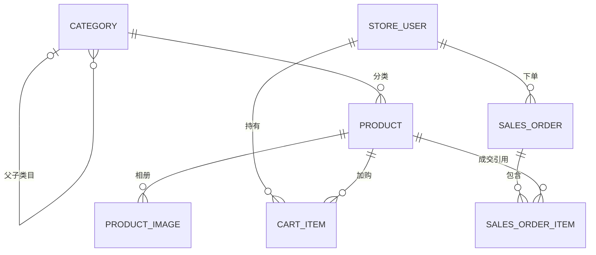

# CSUCampusCraft 数据库设计

CSUCampusCraft 的两个独立应用使用同一个 MySQL 8.4 数据库 `csucampuscraft`，共享七张 InnoDB 业务表。这里定义初始化脚本使用的实际结构、写入边界和后续交易约束。初始化实测与业务用例分别记录在[测试与验收用例](测试与验收用例.md)。

## 基线与初始化

- 项目基线为 MySQL 8.4 与 InnoDB。历史初始化记录使用 MySQL 8.4.9 验证过脚本导入与双端连接。该记录缺少精确 Git SHA，本轮验证和版本边界见测试文档。连接会话使用 UTC，业务时间字段使用 `TIMESTAMP(6)` 保存时间点，页面统一按 `Asia/Shanghai` 展示。
- 先创建并选中 `csucampuscraft` UTF-8 空库，库字符集为 `utf8mb4`，排序规则为 `utf8mb4_0900_as_ci`。脚本在当前连接所选库执行，首次导入选择一份。 [仅建表](../database/01-schema.sql) · [建表与演示数据](../database/02-schema-with-demo.sql)
- 两份脚本共用相同的七表 DDL。MySQL 建表语句会隐式提交，因此脚本失败后已建表可能保留。演示数据在建表后以单独事务写入，提交前校验行数和订单明细金额。使用 MySQL 客户端批处理并在出错时停止。失败重试在确认可重建的隔离空库进行。
- 应用设置 `spring.sql.init.mode=never`。已初始化的开发库随结构变更采用独立迁移步骤，两个初始脚本一起维护。
- 导入后的数量依次为 4 个账号、15 个分类、60 个商品、100 条相册记录、10 个车条目、10 张订单、20 条订单明细。五个一级主题各含文具和纪念周边两个二级类目，每个二级类目 6 个商品。教学账号、命令与连接配置见 [README](../README.md)。

## 实体关系



关系图描述表级引用。Service 负责约束二级类目才能挂商品、最多两层、有效订单至少有一条明细、同单明细小计之和等于订单总额。全部外键为 `ON DELETE RESTRICT ON UPDATE RESTRICT`，例如 DRAFT 商品仍会阻止其所属类目被删除。

## 字段字典

所有表的 `id` 均为 `BIGINT AUTO_INCREMENT` 主键，由 MySQL 发号。下表中「必填」表示 `NOT NULL`，「无」表示未声明默认值，允许空的列未提供时存 `NULL`。

### 账号表 store_user

| 字段 | 类型 | 必填及默认 | 说明 |
| --- | --- | --- | --- |
| `id` | `BIGINT` | 必填，自增主键 | 账号主键。 |
| `username` | `VARCHAR(50)` | 必填，无 | 登录名，去除首尾空白后非空，不区分大小写、区分重音地唯一。 |
| `password_hash` | `VARCHAR(255)` | 必填，无 | BCrypt 密码散列，成本为 10。数据库仅检查非空，算法、成本和密码匹配由认证服务负责，禁止展示散列。 |
| `display_name` | `VARCHAR(50)` | 必填，无 | 非空显示名。 |
| `role` | `VARCHAR(16) COLLATE utf8mb4_0900_bin` | 必填，无 | `CUSTOMER` 或 `ADMIN`。 |
| `status` | `VARCHAR(16) COLLATE utf8mb4_0900_bin` | 必填，`ENABLED` | `ENABLED` 或 `DISABLED`。 |
| `email` | `VARCHAR(100)` | 可空 | 联系邮箱。 |
| `phone` | `VARCHAR(30)` | 可空 | 联系电话，独立于订单收货快照。 |
| `created_at` | `TIMESTAMP(6)` | 必填，`CURRENT_TIMESTAMP(6)` | 建立时间。 |
| `updated_at` | `TIMESTAMP(6)` | 必填，`CURRENT_TIMESTAMP(6)`，`ON UPDATE` | 账号更新时间及会话认证戳。真实启停由 Service 显式单调推进，重复同状态不写。 |

### 分类表 category

| 字段 | 类型 | 必填及默认 | 说明 |
| --- | --- | --- | --- |
| `id` | `BIGINT` | 必填，自增主键 | 分类主键。 |
| `code` | `VARCHAR(32)` | 必填，无 | 非空稳定编码，全局不区分大小写、区分重音地唯一。一级经 Service 限制为 1–21 字符，二级由父编码与类型后缀生成，最长 32 字符。 |
| `parent_id` | `BIGINT` | 可空 | 引用 `category.id`，一级为 `NULL`，二级必须指向合法一级。 |
| `parent_key` | `BIGINT` | 生成列，`COALESCE(parent_id, 0)` | 将一级归入同一个同名判断范围，由数据库生成。 |
| `name` | `VARCHAR(50)` | 必填，无 | 非空名称，同父级范围内名称唯一，比较采用默认排序规则。 |
| `sort_order` | `INTEGER` | 必填，`0` | 非负，数值较小的分类排前。 |
| `created_at` | `TIMESTAMP(6)` | 必填，`CURRENT_TIMESTAMP(6)` | 建立时间。 |
| `updated_at` | `TIMESTAMP(6)` | 必填，`CURRENT_TIMESTAMP(6)`，`ON UPDATE` | 最后更新时间。 |

### 商品表 product

| 字段 | 类型 | 必填及默认 | 说明 |
| --- | --- | --- | --- |
| `id` | `BIGINT` | 必填，自增主键 | 商品主键。 |
| `sku` | `VARCHAR(40)` | 必填，无 | 非空且不区分大小写、区分重音地唯一，创建后固定。 |
| `category_id` | `BIGINT` | 必填，无 | 引用 `category.id`，Service 验证为二级。 |
| `name` | `VARCHAR(120)` | 必填，无 | 非空商品名称。 |
| `summary` | `VARCHAR(500)` | 可空 | 列表可用的短介绍。 |
| `description` | `TEXT` | 可空 | 商品详情，按纯文本输出。 |
| `cover_image` | `VARCHAR(255)` | 必填，`images/catalog-placeholder.svg` | 非空站内相对路径。 |
| `price` | `DECIMAL(12,2)` | 必填，无 | 正数人民币单价。 |
| `stock` | `INTEGER` | 必填，`0` | 非负整数可售库存。 |
| `status` | `VARCHAR(16) COLLATE utf8mb4_0900_bin` | 必填，`DRAFT` | `DRAFT` 或 `ON_SALE`。 |
| `sort_order` | `INTEGER` | 必填，`0` | 非负，用于默认排序与精选推荐。 |
| `version` | `BIGINT` | 必填，`0` | 非负版本。价格、状态、资料、库存或相册实际变更时递增。相册没有独立版本，复用父商品版本。 |
| `created_at` | `TIMESTAMP(6)` | 必填，`CURRENT_TIMESTAMP(6)` | 建立时间，用于新品排序。 |
| `updated_at` | `TIMESTAMP(6)` | 必填，`CURRENT_TIMESTAMP(6)`，`ON UPDATE` | 最后更新时间。 |

### 相册表 product_image

| 字段 | 类型 | 必填及默认 | 说明 |
| --- | --- | --- | --- |
| `id` | `BIGINT` | 必填，自增主键 | 相册图片记录主键。 |
| `product_id` | `BIGINT` | 必填，无 | 引用 `product.id`。 |
| `image_path` | `VARCHAR(255)` | 必填，无 | 非空、最多 255 字符的站内 `images/` 相对路径，合法性由 Service 检查。 |
| `alt_text` | `VARCHAR(120)` | 可空 | 可读替代文本，最多 120 字符。 |
| `sort_order` | `INTEGER` | 必填，`0` | 非负，按 `sort_order ASC, id ASC` 读取。 |

### 购物车表 cart_item

| 字段 | 类型 | 必填及默认 | 说明 |
| --- | --- | --- | --- |
| `id` | `BIGINT` | 必填，自增主键 | 车条目主键。 |
| `user_id` | `BIGINT` | 必填，无 | 引用 `store_user.id`，从当前会话取得。 |
| `product_id` | `BIGINT` | 必填，无 | 引用 `product.id`，与用户 ID 组成唯一条目。 |
| `quantity` | `INTEGER` | 必填，`1` | 单 SKU 数量为 1 至 99。导航徽标是本人全部条目 `SUM(quantity)`，包括失效条目，游客或空车为 0。 |
| `version` | `BIGINT` | 必填，`0` | 非负，修改与移除校验版本，成功改量递增。 |
| `created_at` | `TIMESTAMP(6)` | 必填，`CURRENT_TIMESTAMP(6)` | 首次加入时间。 |
| `updated_at` | `TIMESTAMP(6)` | 必填，`CURRENT_TIMESTAMP(6)`，`ON UPDATE` | 最后更新时间。 |

购物车金额从当前商品价格计算。结算确认临时快照放在当前用户会话，内容包括账号、整车条目 ID、商品、数量、版本和单价。该快照参与提交校验。持久化成交快照在订单中保存。

### 订单表 sales_order

| 字段 | 类型 | 必填及默认 | 说明 |
| --- | --- | --- | --- |
| `id` | `BIGINT` | 必填，自增主键 | 内部主键。 |
| `order_no` | `VARCHAR(40)` | 必填，无 | 非空业务单号，不区分大小写、区分重音地唯一。 |
| `user_id` | `BIGINT` | 必填，无 | 引用 `store_user.id`，订单归属。 |
| `status` | `VARCHAR(16) COLLATE utf8mb4_0900_bin` | 必填，`PENDING_PAYMENT` | 待支付、已支付待发货、已发货、已完成或已取消。 |
| `total_amount` | `DECIMAL(12,2)` | 必填，无 | 正数应付总额。 |
| `receiver_name` | `VARCHAR(50)` | 必填，无 | 收货人快照，去除首尾空白后非空。 |
| `receiver_phone` | `VARCHAR(30)` | 必填，无 | 联系电话快照，去除首尾空白后非空。 |
| `receiver_address` | `VARCHAR(255)` | 必填，无 | 完整收货地址快照，去除首尾空白后非空。 |
| `created_at` | `TIMESTAMP(6)` | 必填，`CURRENT_TIMESTAMP(6)` | 创建订单时间。 |
| `updated_at` | `TIMESTAMP(6)` | 必填，`CURRENT_TIMESTAMP(6)`，`ON UPDATE` | 最后更新时间。 |
| `payment_method` | `VARCHAR(16) COLLATE utf8mb4_0900_bin` | 可空 | 模拟支付成功后为 `MOCK`。 |
| `payment_no` | `VARCHAR(40)` | 可空 | 首次模拟支付成功的非空凭证，存在时不区分大小写、区分重音地唯一。 |
| `paid_at` | `TIMESTAMP(6)` | 可空 | 首次模拟支付成功时间。 |
| `cancelled_at` | `TIMESTAMP(6)` | 可空 | 仅 `CANCELLED` 存在。 |
| `shipped_at` | `TIMESTAMP(6)` | 可空 | `SHIPPED` 或 `COMPLETED` 时存在。 |
| `completed_at` | `TIMESTAMP(6)` | 可空 | 仅 `COMPLETED` 存在。 |

状态和字段必须相符。`PENDING_PAYMENT` 与 `CANCELLED` 的支付方式、凭证和支付时间均为空。`PAID`、`SHIPPED`、`COMPLETED` 须保存完整的模拟支付记录。支付或取消时间不得早于创建，发货不得早于支付，完成不得早于发货。合法迁移由 [需求与业务规则](需求与业务规则.md) 的 BR-08 定义。

### 订单明细表 sales_order_item

| 字段 | 类型 | 必填及默认 | 说明 |
| --- | --- | --- | --- |
| `id` | `BIGINT` | 必填，自增主键 | 明细主键。 |
| `order_id` | `BIGINT` | 必填，无 | 引用 `sales_order.id`。 |
| `product_id` | `BIGINT` | 必填，无 | 引用 `product.id`，同单同商品最多一行。 |
| `sku_snapshot` | `VARCHAR(40)` | 必填，无 | 非空成交时 SKU。 |
| `product_name_snapshot` | `VARCHAR(120)` | 必填，无 | 非空成交时商品名。 |
| `cover_image_snapshot` | `VARCHAR(255)` | 必填，无 | 非空成交时封面路径。 |
| `unit_price` | `DECIMAL(12,2)` | 必填，无 | 正数成交单价。 |
| `quantity` | `INTEGER` | 必填，无 | 成交数量，1 至 99。 |
| `line_amount` | `DECIMAL(12,2)` | 必填，无 | 正数，等于 `unit_price × quantity`。 |

`store_user`、`category`、`product`、`cart_item` 和 `sales_order` 的 `updated_at` 声明 `ON UPDATE CURRENT_TIMESTAMP(6)`。其他列实际发生变更且语句未显式赋值 `updated_at` 时，由 MySQL 更新时间。账号真实启停为会话失效提供严格变化的认证戳，Service 显式赋值 `updated_at = GREATEST(CURRENT_TIMESTAMP(6), updated_at + INTERVAL 1 MICROSECOND)`，覆盖该次语句的自动时间更新。重复设置相同状态不发出 UPDATE，保留原时间。

金额在 Service 用 `BigDecimal` 计算，写入前校验小数位和范围。`DECIMAL(12,2)` 最大正值为 9,999,999,999.99 元。单价可存时也要单独校验小计与汇总，避免数量乘积或总价超出范围。

## 约束与索引

主键和普通 `UNIQUE` 约束自带索引。下表列出查询和约束采用的具体键。

| 表 | 唯一索引或约束 | 查询索引 |
| --- | --- | --- |
| `store_user` | `uk_user_username(username)` | 登录按用户名等值查询。 |
| `category` | `uk_category_code(code)`，`uk_category_sibling_name(parent_key, name)` | `idx_category_parent_sort(parent_id, sort_order, id)`。 |
| `product` | `uk_product_sku(sku)` | `idx_product_category_status_sort(category_id, status, sort_order, id)`、`idx_product_status_sort(status, sort_order, id)`。 |
| `product_image` | 主键 | `idx_image_product_sort(product_id, sort_order, id)`。 |
| `cart_item` | `uk_cart_user_product(user_id, product_id)` | `idx_cart_product(product_id)`。 |
| `sales_order` | `uk_order_no(order_no)`，`uk_order_payment_no(payment_no)`。后者允许多个 `NULL`，非空凭证须唯一。 | `idx_order_user_created(user_id, created_at, id)`、`idx_order_status_created(status, created_at, id)`。 |
| `sales_order_item` | `uk_order_item_product(order_id, product_id)` | `idx_order_item_product(product_id)`。 |

登录名、SKU、类目编码和名称、订单号与支付号使用 `utf8mb4_0900_as_ci`。普通等值比较即可按大小写不敏感、重音敏感的口径匹配，并沿用唯一索引。角色、状态和支付方式使用 `utf8mb4_0900_bin` 区分枚举字面值。商品名包含匹配时先转义通配符，使用绑定参数和明确的转义字符。现有索引支撑关联、常用筛选和稳定排序，是否增加搜索索引由执行计划与数据规模决定。

`parent_key = COALESCE(parent_id, 0)` 是存储生成列，让一级主题也纳入同名检查。Mapper 写 `parent_id`，生成列由数据库维护。分类删除先核对子类和全部商品引用，商品归属校验二级类目。并发新引用与删除冲突时，以外键限制为底线，Service 返回可理解的冲突结果。

| 约束责任 | 规则与边界 |
| --- | --- |
| InnoDB | 主键、外键、唯一键、非空、数量和库存范围、金额正值、行金额等式、订单状态配套字段与时间先后。 |
| Service | 两级分类结构与二级编码后缀、角色和资源归属、每车种类上限、订单明细齐备与总额校验、旧版本、状态迁移、归属范围与事务副作用。 |
| 页面与请求适配 | 只展示当前允许的动作，失败解释可恢复步骤。表单校验结果用于反馈，最终写入条件由服务端重新检查。 |

### CHECK 约束完整清单

两份初始化脚本实际各声明 **35 个 `CHECK`**，下表逐个对应现有 DDL。它们均由 MySQL 数据库执行，适用于应用写入和直接 SQL 写入。`NOT NULL`、字段长度、主外键、唯一索引和生成列不计入这个数量。对非空字符串的数据库检查只判定 `TRIM` 后长度大于 0，不自动去除存储值的首尾空白，也不验证路径安全、电话格式或 BCrypt 算法。

| 归属表 | 约束名 | DDL 谓词或等价完整含义 | 执行责任 |
| --- | --- | --- | --- |
| `store_user` | `ck_user_username` | `CHAR_LENGTH(TRIM(username)) > 0`。 | DB CHECK |
| `store_user` | `ck_user_password` | `CHAR_LENGTH(TRIM(password_hash)) > 0`。 | DB CHECK |
| `store_user` | `ck_user_display_name` | `CHAR_LENGTH(TRIM(display_name)) > 0`。 | DB CHECK |
| `store_user` | `ck_user_role` | `role IN ('CUSTOMER', 'ADMIN')`。 | DB CHECK |
| `store_user` | `ck_user_status` | `status IN ('ENABLED', 'DISABLED')`。 | DB CHECK |
| `category` | `ck_category_code` | `CHAR_LENGTH(TRIM(code)) > 0`。 | DB CHECK |
| `category` | `ck_category_name` | `CHAR_LENGTH(TRIM(name)) > 0`。 | DB CHECK |
| `category` | `ck_category_sort` | `sort_order >= 0`。 | DB CHECK |
| `product` | `ck_product_sku` | `CHAR_LENGTH(TRIM(sku)) > 0`。 | DB CHECK |
| `product` | `ck_product_name` | `CHAR_LENGTH(TRIM(name)) > 0`。 | DB CHECK |
| `product` | `ck_product_cover` | `CHAR_LENGTH(TRIM(cover_image)) > 0`。 | DB CHECK |
| `product` | `ck_product_price` | `price > 0`。 | DB CHECK |
| `product` | `ck_product_stock` | `stock >= 0`。 | DB CHECK |
| `product` | `ck_product_status` | `status IN ('DRAFT', 'ON_SALE')`。 | DB CHECK |
| `product` | `ck_product_sort` | `sort_order >= 0`。 | DB CHECK |
| `product` | `ck_product_version` | `version >= 0`。 | DB CHECK |
| `product_image` | `ck_image_path` | `CHAR_LENGTH(TRIM(image_path)) > 0`。 | DB CHECK |
| `product_image` | `ck_image_sort` | `sort_order >= 0`。 | DB CHECK |
| `cart_item` | `ck_cart_quantity` | `quantity BETWEEN 1 AND 99`。 | DB CHECK |
| `cart_item` | `ck_cart_version` | `version >= 0`。 | DB CHECK |
| `sales_order` | `ck_order_no` | `CHAR_LENGTH(TRIM(order_no)) > 0`。 | DB CHECK |
| `sales_order` | `ck_order_total` | `total_amount > 0`。 | DB CHECK |
| `sales_order` | `ck_order_receiver` | 收货人、电话、地址的 `CHAR_LENGTH(TRIM(...))` 全部大于 0。 | DB CHECK |
| `sales_order` | `ck_order_status` | `status IN ('PENDING_PAYMENT', 'PAID', 'SHIPPED', 'COMPLETED', 'CANCELLED')`。 | DB CHECK |
| `sales_order` | `ck_order_payment_info` | 待支付或已取消时，`payment_method`、`payment_no`、`paid_at` 全为 `NULL`。已支付、已发货或已完成时，三者全非空，方式须为 `MOCK`，支付号去空白后非空。 | DB CHECK |
| `sales_order` | `ck_order_cancel_time` | 当且仅当状态为 `CANCELLED` 时 `cancelled_at` 非空，其余状态该字段为空。 | DB CHECK |
| `sales_order` | `ck_order_ship_time` | 当且仅当状态为 `SHIPPED` 或 `COMPLETED` 时 `shipped_at` 非空，其余状态该字段为空。 | DB CHECK |
| `sales_order` | `ck_order_complete_time` | 当且仅当状态为 `COMPLETED` 时 `completed_at` 非空，其余状态该字段为空。 | DB CHECK |
| `sales_order` | `ck_order_time_sequence` | 四项同时成立。`paid_at IS NULL OR paid_at >= created_at`，`cancelled_at IS NULL OR cancelled_at >= created_at`，`shipped_at IS NULL OR shipped_at >= paid_at`，`completed_at IS NULL OR completed_at >= shipped_at`。结合前述状态配套约束保证时间链完整。 | DB CHECK |
| `sales_order_item` | `ck_order_item_sku` | `CHAR_LENGTH(TRIM(sku_snapshot)) > 0`。 | DB CHECK |
| `sales_order_item` | `ck_order_item_name` | `CHAR_LENGTH(TRIM(product_name_snapshot)) > 0`。 | DB CHECK |
| `sales_order_item` | `ck_order_item_cover` | `CHAR_LENGTH(TRIM(cover_image_snapshot)) > 0`。 | DB CHECK |
| `sales_order_item` | `ck_order_item_price` | `unit_price > 0`。 | DB CHECK |
| `sales_order_item` | `ck_order_item_quantity` | `quantity BETWEEN 1 AND 99`。 | DB CHECK |
| `sales_order_item` | `ck_order_item_amount` | `line_amount > 0 AND line_amount = unit_price * quantity`。 | DB CHECK |

分表数量为 `5 + 3 + 8 + 2 + 2 + 9 + 6 = 35`。在结构版和演示版导入后的当前库执行以下只读查询，保存实际名称、谓词和 `ENFORCED` 值。要求 35 条且均为 `YES`。MySQL 可能规范化谓词的大小写、引号和括号，核对语义与名称，不以显示文本逐字相等判断。

```sql
SELECT tc.TABLE_NAME, tc.CONSTRAINT_NAME, cc.CHECK_CLAUSE, tc.ENFORCED
FROM information_schema.TABLE_CONSTRAINTS tc
JOIN information_schema.CHECK_CONSTRAINTS cc
  ON cc.CONSTRAINT_SCHEMA = tc.CONSTRAINT_SCHEMA
 AND cc.CONSTRAINT_NAME = tc.CONSTRAINT_NAME
WHERE tc.CONSTRAINT_SCHEMA = DATABASE()
  AND tc.CONSTRAINT_TYPE = 'CHECK'
ORDER BY tc.TABLE_NAME, tc.CONSTRAINT_NAME;
```

### Service 补充校验与查询口径

| 业务范围 | DB 已有底线 | Service 必须补充的规则 |
| --- | --- | --- |
| 分类 | 编码和同父名称唯一，父 ID 外键有效，非空与非负。 | 一级编码去空白后 1–21 字符，22 字符返回 400。`_STATIONERY` 长 11，最长二级编码为 `21 + 11 = 32`；`_SOUVENIR` 长 9。二级编码只由服务端拼接，最多两级，每主题每类型最多一条，禁止编辑编码和父级。 |
| 账号与普通顾客管理 | 角色、状态为合法枚举，用户名唯一。 | BCrypt 成本 10，校验启用状态与本端角色。顾客列表、详情及启停限定 `role='CUSTOMER'`，请求账号 ID 不能扩大为管理员。禁止通过启停动作改账号资料、角色或密码，禁止物理删顾客。登录会话保存 `authStamp`，等于当时账号 `updated_at` 的完整 UTC 微秒值。每次受保护请求重查状态、角色及认证戳，任一不匹配清除本端会话；真实启停单调推进戳，重新启用后旧会话同样须重新登录。受保护写入在锁当前用户后再次核对状态、角色和认证戳。 |
| 相册 | 图片引用存在的商品，路径非空、排序非负。 | 路径以 `images/` 开头，不接收绝对 URL、绝对磁盘路径或路径穿越。先锁操作者并复核认证，再锁父商品校验 `productVersion`，然后核对相册记录归属父商品。实际新增、编辑或删除增父商品版本；没有图片独立版本。 |
| 购物车 | 单用户同商品唯一，单行数量 1–99，商品和用户外键有效。 | 用户来源于当前会话，最多 20 种 SKU，包括失效行。检查上架、库存、版本和归属。徽标取本人全部 `SUM(quantity)`，不按有效性或库存过滤，不以 `COUNT(*)` 代替。 |
| 订单 | 状态取值和配套字段、时间链、行小计相等。 | 检查合法状态迁移和本人归属，至少一条明细、总额等于所有明细小计，金额精度与范围，库存锁和原子副作用。DB CHECK 本身不能阻止跳过 `PAID` 的非法业务迁移。 |
| 真实控制台 | 七表可提供当前数据，不新增缓存计数或汇总表。 | BR-18 的五项即时计数分别限定商品上架、商品草稿、订单 `PAID`、启用 CUSTOMER、禁用 CUSTOMER。管理员不计入顾客人数，待支付/已发货/已取消单不计入待发货。 |

新管理功能复用现有七表，不增加字段、计数表、相册版本列或账号角色。当前实现进度与实测结果见 [README 的「当前阶段」](../README.md#当前阶段)和[《测试与验收用例》的实测记录](测试与验收用例.md)；本文件保持表结构、约束与补充校验的设计口径。普通顾客查询优先使用现有主键或 `uk_user_username`，名称包含查询需在真实规模上评估执行计划。`role/status` 统计和包含筛选可能全表扫描，首版教学数据可接受；若后续量级或实测耗时需要新增索引，先记录迁移、收益和双脚本同步变更，不将规划索引描述成已有索引。

## 主键与数据变更

演示脚本对 `store_user`、`category`、`product` 写入显式种子 ID。InnoDB 自增值随显式写入推进，后续新增继续由 MySQL 发号。两端 `Category.id` 均声明 `@TableId(type = IdType.AUTO)`。Mapper 接收 `id` 为空的实体，插入省略该列，再将 JDBC 返回的主键回填。事务回滚和并发插入可能留下主键间隔，订单对外使用独立的唯一业务单号。历史隔离测试中，实际管理端和用户端 Mapper 分别回填 MySQL 生成的 ID 504 和 505。该次记录缺少精确 Git SHA。完整证据见[测试与验收用例](测试与验收用例.md)。

## 写入责任与事务

| 数据 | 主要读写边界 |
| --- | --- |
| `store_user` | 演示账号由初始化导入。双端按各自角色读取并校验状态。管理端仅查询普通顾客和切换其启用状态，角色、密码、资料及原购物车和订单保持不变。 |
| `category` | 用户端读取目录。管理端创建、改名称与排序、删除无引用类目。 |
| `product_image` | 用户端读有序相册。管理端维护相册记录及元数据，使用共享已有素材，不上传、不删除物理文件，不改历史订单封面快照。 |
| `product` | 管理端负责录入、资料、上架状态和补货。用户端下单和取消更新库存与版本。 |
| `cart_item` | 用户端按本人账号加购、改量、移除或随下单清理。 |
| `sales_order` | 用户端创建、模拟支付、取消和选做确认收货。管理端读全站订单并发货。 |
| `sales_order_item` | 用户端下单事务写入，双端详情读取原成交快照。 |

规划中的交易在 InnoDB `READ COMMITTED` 下使用显式行锁和条件更新，交易 Service 声明该隔离级别。所有受保护写入先锁当前操作者的用户行，重新验证状态、角色及 `authStamp`，再按下表锁定其业务资源；读请求在入口重查认证戳。锁定读取和对应写入在同一事务、同一数据库连接内执行。业务规则见 BR-04 至 BR-11。

| 操作 | 事务及锁顺序 |
| --- | --- |
| 购物车写入 | 先锁当前用户行，复核状态、角色及 `authStamp` 后读取该用户车。加购、修改在事务内校验数量、SKU 品种上限和库存。修改与移除检查条目版本，失效条目仍可移除。 |
| 整车下单 | 先锁用户行并复核状态、角色及 `authStamp`，再核对当前整车和确认快照，再按商品 ID 升序对涉及商品执行 `SELECT ... FOR UPDATE`。用锁内最新商品行校验价格、状态和库存。原子写订单及明细、按数量扣库存、递增商品版本、删除已核对的结算条目。扣减以库存下限作条件并核对影响行数，任何一步失败均回滚。 |
| 支付与取消 | 先锁当前用户并复核状态、角色及 `authStamp`，再按完整单号与本人归属锁同一订单行，随后校验状态。支付成功只写首份凭证和时间。取消再按商品 ID 升序锁定全部明细对应商品，返库、增加版本与写取消状态同一提交。 |
| 商品编辑与补货 | 编辑和上下架按预期版本条件更新。补货按商品主键，在数据库当前库存上累加正整数，并增加版本。补货溢出或商品不存在时整次失败。 |
| 顾客启停 | 锁目标用户行后校验角色为 CUSTOMER，再在当前状态基础上更新。真实变化显式单调推进 `updated_at`；重复设置同一状态不写、不改变时间。管理员写请求先锁并复核自身账号的认证戳，再锁目标普通顾客。该目标行锁与用户端车和下单的用户锁协调。已提交业务保留，禁用成功后新进入的受保护请求不得继续处理，原会话清除后需重新登录。 |
| 相册维护 | 先锁操作者并复核认证，再按父商品 ID 加 `FOR UPDATE`，校验提交的父 `productVersion`，编辑或删除再按父商品范围查相册记录。实际变更与父商品 `version + 1` 同一事务提交。归属错误、旧版、无效路径及排序拒绝后均无部分更新。 |
| 发货与选做确认收货 | 分别按 `PAID`、`SHIPPED` 做条件迁移，首次成功记录时间，重复请求保留原记录。 |

同一账号的下单和改车由用户行锁协调。两账号抢库存为 1 的 SKU 时，各自拥有不同用户锁，实际竞争同一商品行。后一事务取得商品锁后重查到 0，整单失败并保留它的购物车。历史隔离库记录观察到后一事务等待并在前一事务提交后读到库存 0，该记录缺少精确 Git SHA。完整业务 HTTP 流程另按 TST-35 验收。并发购买和补货以已提交的库存为准，例子中 10 减 2 加 3 后应为 11。

### 交易写入检查

- 整车下单先锁操作者用户行并复核身份，再按商品主键升序锁定涉及的行，锁内重新读取单价、上架状态和库存。扣减 SQL 包含 `stock >= 购买量`，受影响行数应为 1。主单、明细、扣库存、递增版本和清理确认条目在同一事务提交，任一步失败均回滚。
- 取消先锁操作者用户行并复核身份，再在订单锁内从成交明细取得原始购买数量。商品按同一顺序锁定，返还量与版本递增同取消状态一起提交。下架商品也按原数量返还，商品上架状态保持原值。库存溢出时整次回滚。
- 商品编辑按 `id` 和 `version` 匹配。补货在数据库当前值上计算并校验上限，避免使用页面旧库存算出绝对值。读写冲突、锁等待超时或死锁结束本次事务，Service 按失败分支反馈，后续请求重新读取。

### 相册、顾客和控制台的实现边界

相册维护页面为管理端 `/products/{productId}/images`。列表按 `sort_order ASC, id ASC` 读取，新增时不接受客户端指定 `id`。编辑和删除以父商品和图片双重条件查询，其他商品的图片返回 404。数据库外键只检查父商品存在，不能替代此资源归属检查。先锁操作者并复核身份，再取父商品锁并校验版本，然后读图片归属，统一与商品编辑、下单及补货的商品版本协调。一个合法且实际发生的相册变更只增父版本一次；有效版本的相同值提交可按成功结果返回，父版本不变。`product_image` 没有更新时间字段，本轮不为相册伪造独立审计记录。

相册与封面独立。删除相册记录只删除数据库行，保留共享文件、`product.cover_image` 及历史 `cover_image_snapshot`。删除最后一条相册后，详情页使用商品封面；封面资源也不可用时再显示共享占位图。封面由商品资料表单修改。多个商品可复用同一素材路径，因而不能把删除某一行解释为删除文件。相册元数据写入不检查运行时磁盘是否存在文件，缺图允许按既定占位机制展示；双端 HTTP 实际可读与字节一致另按 INIT-05、TST-40 检查。

顾客详情按 CUSTOMER 身份读取当前资料与关联订单入口，只显示供业务查询使用的用户名、显示名、状态、邮箱、电话及创建时间，不读取或输出 `password_hash`。关联订单筛选仍由管理员授权，不能因为 URL 带有 `userId` 而扩展到其他角色。启停不清理购物车、不取消或返库订单、不改支付状态，发货仍按订单自身状态进行。登录成功把账号 `updated_at` 的完整 UTC 微秒值保存为本端会话 `authStamp`。受保护请求从数据库读取并比较该值，且重查启用状态和角色，认证戳不符即清除会话。真实启用或禁用均显式设置 `updated_at = GREATEST(CURRENT_TIMESTAMP(6), updated_at + INTERVAL 1 MICROSECOND)`，保证同一微秒内的两次切换也能使旧认证戳失效，重复设置同一状态不写入。因此「禁用后立即启用，中间旧会话没有请求」也不能恢复旧会话，须重新登录。此方案复用现有字段，不新增会话版本列。受保护写事务在先锁当前用户后再次核对状态、角色和认证戳，防止入口校验与实际写入之间的禁用竞争。

控制台五项计数使用一条含独立子查询的 SELECT 取得，避免同页各项来自不同时间。刷新后读取已提交结果，不做跨请求的强一致承诺。分别等价于 `product.status='ON_SALE'`、`product.status='DRAFT'`、`sales_order.status='PAID'`、`store_user.role='CUSTOMER' AND status='ENABLED'`、`store_user.role='CUSTOMER' AND status='DISABLED'` 的行数。库存为 0 的上架商品仍计为上架商品，相册行数、订单明细数量与管理员账号均不混入这些计数。筛选跳转时带相同状态条件。

## 演示数据与资源路径

| SKU | 种子状态 | 使用场景 |
| --- | --- | --- |
| `CSU-LMK-NOTE-01` | 上架，18.00 元，10 本 | 85 元整车和购买补货并发。 |
| `CSU-GRAD-BOX-01` | 上架，49.00 元，12 盒 | 毕业专区、独立成品礼盒扣减与返库。 |
| `CSU-COL-PEN-01` | 上架，1 件 | 购物车已有数量大于现存库存。 |
| `CSU-CLB-FOLDER-02` | 下架 | 旧车条目失效。 |
| `CSU-SPT-STAND-01` | 上架，库存 0 | 售罄和提交拦截。 |
| `CSU-CLB-STAND-01` | 封面路径故意缺失 | 商品详情占位回退。 |

`alice` 的种子车共有 6 条，其中 3 条失效。85 元演示先在隔离测试库用购物车移除操作清空，再添加 2 本方格本和 1 盒礼盒。金额为 `2 × 18.00 + 49.00 = 85.00` 元。夹具核对和后续页面流程按[测试与验收用例](测试与验收用例.md)执行。

封面和相册使用站内相对路径，两端构建都从仓库 `assets/` 打包。更换素材时要保留历史订单快照引用的资源路径。礼盒是独立成品 SKU，按盒处理库存。组合内容对应单品的库存分别管理。

