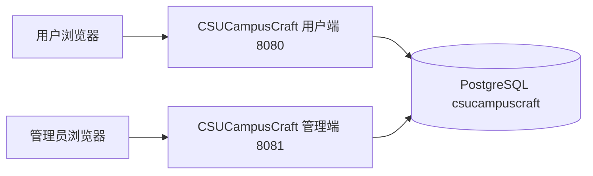
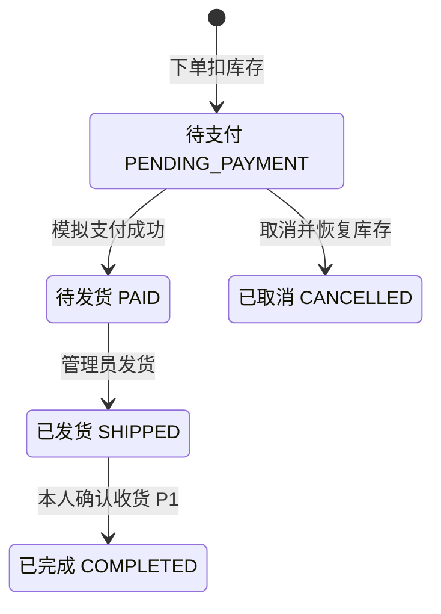

# CSUCampusCraft 系统架构与共享数据契约

CSUCampusCraft 由两个独立启动的 Spring Boot 应用组成。用户端处理公开浏览和本人交易，管理端维护商品并处理全站订单。两端以同一个 PostgreSQL 数据库为集成边界。变更共享字段、分类规则或订单状态前，由两端负责人共同核对读写影响。

## 运行结构

| 项目 | 用户端 | 管理端 |
| --- | --- | --- |
| Maven 工程目录 | `csucampuscraft-user` | `csucampuscraft-admin` |
| Maven artifactId 和应用名 | `csucampuscraft-user` | `csucampuscraft-admin` |
| 默认 HTTP 端口 | `8080` | `8081` |
| 会话 Cookie 名 | `CSUCAMPUSCRAFT_USER_SESSION` | `CSUCAMPUSCRAFT_ADMIN_SESSION` |
| 首个可验证页面 | `GET /` 显示用户端和一级主题 | `GET /` 显示管理端和一级主题 |
| 后续受保护身份 | `CUSTOMER` | `ADMIN` |

构建目标为 Java 17，使用 Spring Boot 3.5.15、Spring MVC、Thymeleaf 和 MyBatis-Plus 3.5.7。初始化页面经 Controller → Service → Mapper 查询 `category`，只读取 `parent_id IS NULL` 的主题，按 `sort_order`、`id` 升序展示。页面中的主题来自查询结果，空库正常展示空状态。首个业务版本将分别把两端入口演进为商城首页和登录后的管理控制台。

各端读取 `CSUCAMPUSCRAFT_DB_URL`、`CSUCAMPUSCRAFT_DB_USER`、`CSUCAMPUSCRAFT_DB_PASSWORD`。默认 URL 为 `jdbc:postgresql://127.0.0.1:5432/csucampuscraft`，默认应用角色为 `csucampuscraft`。联调时给两个进程传入同一目标库的连接参数。具体构建与启动命令见 [README](../README.md)。

- Controller 负责参数绑定、登录身份获取、选择页面或跳转。查询结果映射为页面需要的字段。
- Service 负责访问权限、业务校验、状态流转与事务。跨表写入的事务从可被 Spring 代理的 Service 入口开始。
- Mapper 负责表读写、排序、条件更新和必要的行锁。锁和更新针对数据库里的实际记录。
- Thymeleaf 负责服务端渲染。价格、库存、账号归属和订单状态均由后端计算或读取。

## 共享表与写入边界

| 表 | 共享规则 | 后续主要写入端 |
| --- | --- | --- |
| `store_user` | 用户名唯一。角色为 `CUSTOMER` 或 `ADMIN`，状态为 `ENABLED` 或 `DISABLED`，只存密码散列。 | 演示账号由 SQL 导入，账号启停和本人改密按实际 P1 范围启用。 |
| `category` | 一级主题的父 ID 为空。二级必须归属合法一级。编码全局唯一，同父名称唯一，编码和父分类在创建时固定。`parent_key` 由数据库生成。 | 管理端 |
| `product` | 唯一 SKU 归属一个二级类目。新商品使用 `DRAFT`，可售时为 `ON_SALE`。库存、价格和状态变动均更新 `version`。 | 管理端维护内容和增量补货，用户端在交易中扣减或恢复库存。 |
| `product_image` | 使用站内资源相对路径，同一商品按排序值和 ID 读取相册。 | 演示数据导入，管理端相册维护按 P1 范围启用。 |
| `cart_item` | 用户与商品组合唯一，数量 1–99，单用户最多 20 种 SKU。修改和移除校验条目版本。 | 用户端 |
| `sales_order` | 订单号唯一，金额和收货信息记录成交快照。支付凭证及状态时间与业务状态相匹配。 | 用户端下单、模拟支付、取消和选做确认收货，管理端发货。 |
| `sales_order_item` | 同一订单每个商品最多一行，保留成交时 SKU、名称、封面路径、单价、数量和小计。 | 用户端下单事务 |

两级关系、商品可售条件、购物车品种上限、订单归属、状态迁移和主单金额汇总由 Service 保证。SQL 约束为写入兜底。可售库存基于数据库当前值计算，订单金额以 `BigDecimal` 汇总并保留两位小数。

PostgreSQL 表使用 `BIGINT` 标识列。演示数据导入显式 ID 后同步序列，日常新增由数据库发号。带 `updated_at` 的表通过触发器更新时间。业务时间用 `TIMESTAMPTZ` 存储，种子按 `Asia/Shanghai` 解释，页面也按该时区展示。用户名、类目编码、同父类目名、SKU、订单号和支付号按 `lower()` 建立不区分大小写的唯一索引，等值查询使用同样表达式。带重音和不带重音的字符按不同值处理。

## 分类、交易与并发

一级主题编码沿用需求文档的五个固定种子编码。二级编码为一级编码加 `_STATIONERY` 或 `_SOUVENIR`。类型参数 `STATIONERY` 匹配文具，`SOUVENIR` 匹配纪念周边，`ALL` 查询两类。以 `category_id` 做商品关联，以稳定编码判断类型。`GRADUATION` 定位毕业专区，礼盒 `CSU-GRAD-BOX-01` 的交易与单品使用同一套订单流程，库存独立结算。

| 操作 | 事务内核对和写入 |
| --- | --- |
| 加购、修改、移除 | 先锁当前用户行。重新读取当前用户的购物车，校验权限、条目版本、数量、品种上限和库存，写入后返回新结果。 |
| 整车下单 | 先锁当前用户行并核对全车条目、数量和条目版本，再以 `SELECT … FOR UPDATE` 按商品 ID 升序锁定涉及的商品。从锁返回的行读取当前价格、上架状态和可售库存。全部满足后写主单和明细快照、扣库存、递增商品版本并清理已核对条目，一起提交。 |
| 模拟支付 | 按订单号和本人身份定位，再锁订单行并核对状态。待支付订单可记录首次 `MOCK` 成功凭证。模拟失败保留待支付状态。 |
| 取消 | 先锁本人订单，再按商品 ID 升序恢复所有明细数量，递增商品版本并写取消状态和时间。状态门槛为 `PENDING_PAYMENT`。 |
| 资料编辑、补货 | 编辑资料按商品版本进行条件更新。补货在数据库当前库存上累加正整数并递增版本。 |
| 发货、确认收货 | 管理员发货按 `PAID → SHIPPED`。选做确认收货按本人 `SHIPPED → COMPLETED`。两者按原状态执行条件更新，首次成功记录对应时间。 |

确认后购物车或单价有变化时，提示重新确认。锁定后发现商品下架、库存不足或条目变动时，结束本次事务并保留购物车。并发支付和取消竞争同一订单行，只有先通过状态校验的一方可以生效。同车并发下单的第二次请求须重新比对整车内容。故障注入测试从实际 Service 入口运行，并在独立连接核对回滚结果。

下单使用 PostgreSQL 的 `READ COMMITTED` 和显式行锁。不同用户有各自的用户行锁，争抢同一商品时由商品行锁串行化。先取得锁的请求扣减最后一件并提交，后一个请求取得锁后从最新记录读到库存为 0，返回库存不足并保留其购物车。库存扣减同时使用库存下限条件并核对受影响行数。

## 共享图片

数据库保存站内相对路径，例如 `images/catalog-placeholder.svg`。素材在仓库根目录 `assets/images/` 维护一份，两端 Maven 构建把该目录内容放进各自的 `classpath:/static/images/`。两端从自己的端口请求相同的 `/images/…` 路径。新增或替换素材时一起检查 8080 和 8081 的响应和内容，保留仍被历史快照引用的资源。商品详情中的缺图回退随商品模块验收。

## 初始化与变更

[结构脚本](../database/01-schema.sql)和[完整初始化脚本](../database/02-schema-with-demo.sql)各自可在空的目标库上单独执行。七表 DDL 统一维护。日常启动读取已有数据，初始化和测试数据恢复由成员显式执行。需要修改结构时，在同一个 PR 中同步两份脚本，并记录已有开发库的迁移步骤。

完整脚本提供 4 个教学账号、15 个分类、60 件商品、100 条相册记录、10 条购物车、10 张订单和 20 条订单明细。首轮图文资源可用 `images/catalog-placeholder.svg`，换成实际素材时同步登记来源和使用许可。历史快照读取订单里保存的路径、名称和价格。

| 演示 SKU | 完整脚本导入后的状态 | 对应用例 |
| --- | --- | --- |
| `CSU-LMK-NOTE-01` | 上架，18.00 元，可售 10 本 | 两端同时购买和补货 |
| `CSU-GRAD-BOX-01` | 上架，49.00 元，可售 12 盒 | 毕业专区、礼盒独立计价和库存 |
| `CSU-COL-PEN-01` | 上架，可售 1 件 | 库存下降后购物车数量超出库存 |
| `CSU-CLB-FOLDER-02` | 下架 | 已入车商品下架后失效 |
| `CSU-SPT-STAND-01` | 上架，可售量为 0 | 售罄展示和结算拦截 |
| `CSU-CLB-STAND-01` | 封面资源故意缺失 | 商品详情占位回退 |

`alice` 的演示车预置了上述方格本、礼盒和失效条目。验证 85.00 元整车演示时，先通过购物车操作清理其他条目，只保留 2 本方格本和 1 盒礼盒。

具体页面规则见[项目需求与双端设计](项目需求与双端设计.md)，变更交接见[组内开发协作指南](组内开发协作指南.md)，并发与回滚证据要求见[验收与联调清单](验收与联调清单.md)。
