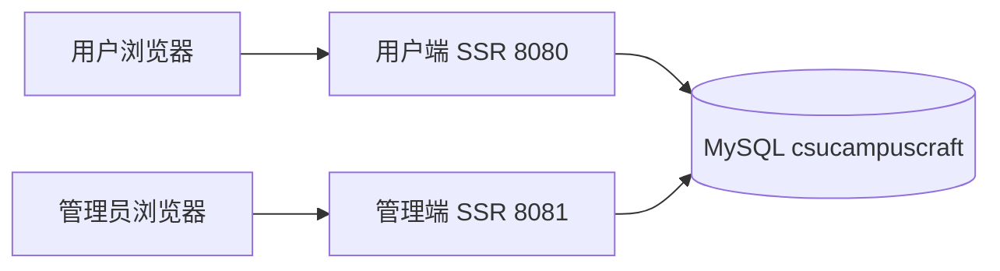

# CSUCampusCraft 系统设计与路由

CSUCampusCraft 使用两个独立的 Spring Boot 应用提供服务端渲染页面。用户端负责目录浏览和本人的购物交易，管理端负责目录、库存和发货。两端以同一个 MySQL 数据库作为集成边界，各自启动并读取同一套表。当前运行能力是两个端口的初始化主题页及共享图片。下文业务路由和 REST 映射供后续实现使用。

## 运行结构

| 配置 | 用户端 | 管理端 |
| --- | --- | --- |
| Maven 工程目录和 artifactId | `csucampuscraft-user` | `csucampuscraft-admin` |
| Java 包前缀 | `org.csucampuscraft.storefront` | `org.csucampuscraft.admin` |
| 默认 HTTP 端口 | `8080` | `8081` |
| 会话 Cookie 名 | `CSUCAMPUSCRAFT_USER_SESSION` | `CSUCAMPUSCRAFT_ADMIN_SESSION` |
| 初始化入口 | `GET /` 渲染一级主题 | `GET /` 渲染一级主题 |
| 业务阶段受保护身份 | 已启用的 `CUSTOMER` | 已启用的 `ADMIN` |

两端都以 Java 17 为构建目标，当前采用 Spring Boot 3.5.15、Spring MVC、Thymeleaf、MyBatis-Plus 3.5.7 和 MySQL Connector/J。应用以独立 JAR 运行，从 `CSUCAMPUSCRAFT_DB_URL`、`CSUCAMPUSCRAFT_DB_USER`、`CSUCAMPUSCRAFT_DB_PASSWORD` 读取连接信息。默认地址为 `jdbc:mysql://127.0.0.1:3306/csucampuscraft`，数据库连接角色默认为 `csucampuscraft`。默认口令为空，实际值从环境变量设置。两端 Hikari 数据源属性均为 `connectionTimeZone=+00:00` 与 `forceConnectionTimeZoneToSession=true`，数据库会话使用 UTC。页面按 `Asia/Shanghai` 展示时间。组员将初始化脚本显式导入已选中的 MySQL 空库，两个应用均配置 `spring.sql.init.mode=never`。构建和启动命令见 [README](../README.md)。

两端构建将仓库 `assets/` 打包进各自 JAR 的 `static/`。网页中的图片通过本端 `/images/…` 读取。两端的 `/images/catalog-placeholder.svg` 是初始化共享素材验证入口。本轮双端均返回 HTTP 200，图片字节一致，见 INIT-05。换真实文创素材时使用相同发布流程，并保留历史订单引用的路径。

## 分层与模块边界

| 层 | 职责 |
| --- | --- |
| Controller | 接收路径、查询和表单参数，取得本端会话身份，调用 Service，选择 Thymeleaf 页面或重定向。 |
| Service | 校验角色、资源归属、业务参数和状态，组装视图所需数据。交易与跨表写入使用受 Spring 管理的事务入口。 |
| Mapper | 执行 MySQL 查询、分页、行锁与条件更新。外部参数绑定后用于查询，排序只从固定规则选择。 |
| Thymeleaf | 服务端渲染表单、数据和页面状态。价格、库存、订单状态和操作权限以 Service 返回的结果为准。 |

当前两端均只有 `HomeController → CategoryService → CategoryMapper` 的读取链路。查询限制 `parent_id IS NULL`，按 `sort_order ASC, id ASC` 渲染根页。以下模块分工对应首个业务版本。

| 模块 | 边界与依赖 | 需求 |
| --- | --- | --- |
| 用户端目录 | 浏览主题、筛选列表、毕业专区与详情，读取分类、商品与相册。 | REQ-02、REQ-03 |
| 两端账号与会话 | 双端分别验证登录与启用状态，并用各自会话管理授权。 | REQ-04 |
| 用户端车与确认 | 持久车由账号归属，结算读取整车，生成会话内短期确认，提交时由交易 Service 再次核对。 | REQ-05、REQ-06 |
| 用户端订单 | 创建、查询本人订单、模拟支付、待支付取消及选做确认收货，读取成交快照。 | REQ-07 至 REQ-10、REQ-13 |
| 管理端目录与库存 | 维护两级分类、商品资料、上下架与增量补货。库存写入以数据库当前值和版本协调。 | REQ-11 |
| 管理端履约 | 查询全站订单与快照，按合法状态执行后台模拟发货。 | REQ-12 |

跨端状态通过共享 MySQL InnoDB 数据库提交和读取。整车下单的订单、明细、库存与清车由同一个用户端 Service 事务提交。写事务显式采用 `READ COMMITTED`。两端库存变化以商品行锁、条件更新和版本约束协调。物理字段与写入细节见[数据库设计](数据库设计.md)，业务条件见[需求与业务规则](需求与业务规则.md)。

## SSR 请求约定

- 用户端公开访问商品目录和登录页。管理员端登录页公开，进入业务阶段后控制台和后台数据需要管理员身份。初始化管理端根页目前只显示公开的一级主题。
- 每次受保护访问从本端会话取得当前账号，核对启用状态、角色及订单或购物车归属。成功登录更新会话标识，退出只结束本端会话。未登录或会话过期时跳转本端登录页，成功登录后可回到经过校验的同端 GET 页面，写操作需由用户重新确认。
- GET 用于页面读取。`GET /checkout` 生成会话内短期确认并渲染确认页，数据库和库存无持久写入。写操作使用 POST 和 CSRF 校验，成功返回 303 到本端可读页面。模拟失败属于合法的支付尝试，返回可读结果并保持待支付状态。
- 非法参数返回 400，权限或 CSRF 校验失败返回 403，不存在或下架的商品返回 404，旧版本、确认失效或不可成交等业务冲突返回 409。业务冲突页说明如何刷新、重新确认或处理失效条目。技术故障显示通用错误页。公开查询符合条件但结果为空时返回 200 和空状态。
- 表单密码、会话标识和完整收货信息不写入常规日志。商品描述、姓名和地址按文本输出，客户端提交的身份、成交金额和库存均由服务端重新确定。具体页面状态见[页面清单与原型](页面清单与原型.md)。

## 用户端路由

用户端路径基于 `8080`。下表中的页面编号与[页面清单与原型](页面清单与原型.md)一致。

| 方法与路径 | 页面或动作 | 访问与行为 | 需求 |
| --- | --- | --- | --- |
| `GET /` | U01 首页 | 公开。当前为主题读取页，业务阶段展示导航、新品、推荐和毕业入口。 | REQ-01、REQ-02 |
| `GET /products` | U02 商品列表 | 公开。毕业专区用 `GRADUATION` 对应主题 ID 进入同一列表。 | REQ-02 |
| `GET /products/{productId}` | U03 商品详情 | 公开。读取当前可展示商品、相册与库存，售罄商品可查看。 | REQ-03 |
| `GET /login`、`POST /login` | U04 登录 | 公开。校验启用的普通账号，失败显示可读提示。 | REQ-04 |
| `POST /logout` | 退出 | 普通用户。清除本端会话后回首页。 | REQ-04 |
| `GET /cart` | U05 购物车 | 普通用户。读取本人车、当前金额和失效原因。 | REQ-05 |
| `POST /cart/items` | 加购 | 普通用户。提交 `productId`、`quantity`。同 SKU 合并。 | REQ-05 |
| `POST /cart/items/{itemId}/quantity` | 改量 | 普通用户。提交 `quantity`、条目 `version`。 | REQ-05 |
| `POST /cart/items/{itemId}/remove` | 移除 | 普通用户。提交条目 `version`，失效条目仍可移除。 | REQ-05 |
| `GET /checkout` | U06 确认整车 | 普通用户。读取整车并建立短期确认。 | REQ-06 |
| `POST /orders` | 提交订单 | 普通用户。提交 `confirmationToken`、`receiverName`、`receiverPhone`、`receiverAddress`。事务成功后重定向订单详情。 | REQ-07 |
| `GET /orders` | U07 本人订单 | 普通用户。按归属查询，支持订单号、状态及分页。 | REQ-08 |
| `GET /orders/{orderNo}` | U08 本人订单详情 | 普通用户。按订单号与归属读取成交快照、时间与可操作状态。 | REQ-08 |
| `GET /orders/{orderNo}/payment`、`POST /orders/{orderNo}/payment` | U09 模拟支付 | 普通用户。提交 `result=SUCCESS` 或 `result=FAILURE`，金额取订单。 | REQ-09 |
| `POST /orders/{orderNo}/cancel` | 取消 | 普通用户。仅本人待支付单可进入取消事务。 | REQ-10 |
| `POST /orders/{orderNo}/receipt` | 确认收货 | P1。普通用户确认本人的已发货订单。 | REQ-13 |

### 商品与订单查询

| 入口 | 参数和默认值 | 规则 |
| --- | --- | --- |
| 用户端 `/products` | `categoryId`、`type`、`q`、`sort`、`page`、`size`。类型默认 `ALL`，排序默认 `DEFAULT`，每页默认 6 条。 | `categoryId` 使用一级主题 ID。二级入口生成父主题 ID 与 `type`。类型可用 `ALL`、`STATIONERY`、`SOUVENIR`。无主题时按选中类型跨主题查询。 |
| 管理端 `/products` | `categoryId`、`q`、`status`、`page`、`size`。每页默认 10 条。 | 按一级主题过滤其全部子类，按二级类目过滤其商品。状态可用 `DRAFT`、`ON_SALE`，省略表示全部。 |
| 双端 `/orders` | `orderNo`、`status`、`page`、`size`。每页默认 10 条。 | 完整订单号去首尾空白后精确匹配，按列的 `utf8mb4_0900_as_ci` 排序规则不区分大小写、区分重音，最多 40 字符，空值表示不限。状态使用 BR-08 中的状态码。用户端额外限制本人。按创建时间和 ID 倒序。 |

名称搜索在去首尾空白后最多 120 字符，空值表示不限，按字面包含匹配，通配符作为文字。用户列表支持 `DEFAULT` 对应 `sort_order ASC, id ASC`，`PRICE_ASC` 对应 `price ASC, id ASC`，`PRICE_DESC` 对应 `price DESC, id ASC`，`NEWEST` 对应 `created_at DESC, id DESC`。管理端商品列表按 `sort_order ASC, id ASC`。页码缺省为 1，小于 1 的整数按 1 处理，每页允许 1 至 50 条。切换条件回第一页，翻页保留条件。超过末页时显示空页并提供返回有效页的入口。分页结果和总数使用同一过滤条件。

## 管理端路由

管理端路径基于 `8081`。业务阶段除登录和静态资源外都要求启用的管理员身份。

| 方法与路径 | 页面或动作 | 行为 | 需求 |
| --- | --- | --- | --- |
| `GET /login`、`POST /login` | A01 管理员登录 | 校验本端身份，成功后进入控制台。 | REQ-04 |
| `POST /logout` | 管理员退出 | 结束本端会话后回本端登录页。 | REQ-04 |
| `GET /` | A02 控制台 | 当前为主题读取页，业务阶段显示管理员身份和管理入口。 | REQ-01、REQ-04 |
| `GET /categories` | A03 分类维护 | 读取两级分类。 | REQ-11 |
| `GET /categories/new`、`GET /categories/{categoryId}/edit` | A03 分类表单 | 录入新分类或编辑名称、排序。 | REQ-11 |
| `POST /categories`、`POST /categories/{categoryId}` | 新增、编辑分类 | 服务端校验层级与唯一性，新增 ID 由 MySQL 生成。 | REQ-11 |
| `POST /categories/{categoryId}/remove` | 删除空分类 | 核对是否有子类及任何商品引用。 | REQ-11 |
| `GET /products` | A04 商品列表 | 按分类、名称、状态查询。 | REQ-11 |
| `GET /products/new`、`GET /products/{productId}/edit` | A05 商品表单 | 展示可编辑资料、库存与版本，旧商品库存只读。 | REQ-11 |
| `POST /products`、`POST /products/{productId}` | 新增、编辑商品 | 新商品为草稿，编辑检查商品版本并保留 SKU。 | REQ-11 |
| `POST /products/{productId}/publish`、`POST /products/{productId}/unpublish` | 上架、下架 | 校验状态和版本，前台读取数据库中的实际结果。 | REQ-11 |
| `POST /products/{productId}/restock` | 增量补货 | 提交正整数 `quantity`，在数据库现有库存上累加。 | REQ-11 |
| `GET /orders` | A06 全站订单 | 按完整订单号、状态及分页查询。 | REQ-12 |
| `GET /orders/{orderNo}` | A07 订单详情 | 展示收货与商品成交快照、模拟凭证和状态时间。 | REQ-12 |
| `POST /orders/{orderNo}/ship` | 模拟发货 | 仅 `PAID` 转 `SHIPPED`，重复请求保留首次发货时间。 | REQ-12 |

## SSR 表单与结果契约

路由表定义请求入口，本节补充业务阶段的输入、校验和跳转。表单字段均从当前端绑定。账号身份、资源所有者、价格和状态由服务端读取，写请求校验 CSRF 后再执行业务。Controller 将类型和范围错误转换为 400，Service 报告已认证但角色或归属不符为 403。不存在的资源返回 404。旧版本、结算失效或当前状态不允许执行的请求返回 409，提示从哪个读页重试。异常与回滚由同一 Service 事务处理。

| 入口 | 请求数据 | 成功结果与异常反馈 |
| --- | --- | --- |
| 双端 `POST /login` | `username`、`password`。返回地址可选，限定为同端允许的 GET 路径。 | 成功更换本端会话标识。用户端返回允许页面或首页，管理员端进控制台。认证失败使用统一提示，避免泄露账号状态。 |
| 用户端加购、改量、移除 | 加购传 `productId`、`quantity`，改量传路径 `itemId`、`quantity`、`version`，移除传路径 `itemId` 与 `version`。 | 成功 303 至购物车。版本校验通过后，相同数量的修改视为无写入成功。移除时条目不存在返回 404，库存、种类上限或旧版本冲突返回 409 并提供重读入口。 |
| `GET /checkout` | 使用本人当前整车。确认快照写入本端会话。 | 生成最新确认令牌，默认有效 10 分钟，可由服务端配置。空车或任何失效条目返回 409 和购物车入口，同时使旧确认失效。 |
| `POST /orders` | `confirmationToken`、`receiverName`、`receiverPhone`、`receiverAddress`。 | 提交成功 303 至新订单详情，提交后清理已使用令牌。字段 400 可沿用仍有效的确认。过期、重开确认或整车/价格/库存冲突返回 409，旧确认失效。 |
| `POST /orders/{orderNo}/payment` | `result=SUCCESS` 或 `result=FAILURE`。 | 待付款模拟失败同样 303 至详情，状态仍为待付款。已付款及其后状态重放 SUCCESS 时显示首次凭证。已取消的支付和已付款后的 FAILURE 返回 409。 |
| 取消、发货、确认收货 | 路径 `orderNo` 和 CSRF。确认收货按 P1 启用。 | 成功或同一动作已处理时 303 至对应订单详情。保留首次状态时间，重复操作不重复变更库存。其他非法状态返回 409。 |
| 后台分类新建或编辑 | 新建传 `name`、`sortOrder`，一级另传 `code`，二级另传 `parentId`、`type`。编辑传 `name`、`sortOrder`。 | 新建由 MySQL 发号。二级编码由服务端按父编码和类型生成，父类层级和同级名称冲突给出定位。成功后回分类列表。 |
| 后台商品新建或编辑 | 新建传 `sku`、`categoryId`、`name`、`summary`、`description`、`coverImage`、`price`、`stock`、`sortOrder`。编辑省略 SKU 和库存，增加 `version`。 | 新建为 `DRAFT`，未填库存或排序时用 0，未填封面时用默认素材。SKU 已占用、所属类目无效或旧版本冲突时回显可修改字段。成功后回商品列表。 |
| 后台上架、下架和补货 | 上下架传 `version`，补货传增量 `quantity`。 | 上下架校验旧状态及版本，重复同状态或旧版本返回 409。每次合法补货在库内现值上增量并递增版本，库存超过范围时失败。成功后回商品列表。 |

结算令牌为服务端生成的不透明值，绑定用户端会话及当前账号。会话只保留最新确认，有效期从创建时计算。快照记录创建时间、整车条目 ID、商品 ID、数量、条目版本及当前单价。重开确认替换旧令牌。下单 Service 在用户行和商品行锁内重查，库存扣减受影响行数与购物车清理结果均需核对。业务冲突时结束当前确认并保留购物车。技术故障回滚时，引导用户先查本人订单和购物车，再重新确认。

用户与管理员两个应用共用状态字段。模拟支付、取消、发货或确认收货在订单锁内检查当前状态。成功后再重定向，另一端的读请求能从数据库查到同一已提交状态。价格、数量、更新时间和库存变化以[需求与业务规则](需求与业务规则.md)为准。

## 未来 REST 映射

以下是 API Contract 的预留部分。首版交付以 SSR 路由为准，JSON 路径待独立客户端立项后实现。REST 与 SSR 适配同一 Service，沿用身份归属、库存及状态规则。

| 领域 | 预留方法与资源 | 请求与返回要点 |
| --- | --- | --- |
| 用户端目录 | `GET /api/v1/home`、`GET /api/v1/products`、`GET /api/v1/products/{productId}` | 沿用查询参数。列表返回 `items`、`page`、`size`、`total`，详情含商品和相册。 |
| 两端会话 | 用户 `POST/DELETE /api/v1/session`，管理 `POST/DELETE /api/v1/admin/session` | 登录接收用户名和密码，返回最少身份字段。会话保留双端角色隔离。 |
| 本人购物车 | `GET /api/v1/cart`、`POST /api/v1/cart/items`、`PATCH/DELETE /api/v1/cart/items/{itemId}` | 加购传商品 ID 与数量，改量和移除传当前版本。返回当前车及失效原因。 |
| 结算及本人订单 | `POST /api/v1/checkout/confirmations`、`GET/POST /api/v1/orders`、`GET /api/v1/orders/{orderNo}` | 确认返回短期令牌与整车，创建接收令牌和收货字段，返回业务单号及状态。 |
| 本人订单动作 | `POST /api/v1/orders/{orderNo}/payments`、`…/cancellations`、`…/receipts` | 保留单独业务动作，返回变更后状态与相应时间。收货随 P1 范围。 |
| 后台目录 | `GET/POST /api/v1/admin/categories`、`PATCH/DELETE /api/v1/admin/categories/{categoryId}`、`GET/POST /api/v1/admin/products`、`PATCH /api/v1/admin/products/{productId}` | 类目和商品维持相同的层级、字段、版本及约束。 |
| 后台库存及履约 | `POST /api/v1/admin/products/{productId}/publication`、`…/restocks`、`GET /api/v1/admin/orders`、`GET /api/v1/admin/orders/{orderNo}`、`POST /api/v1/admin/orders/{orderNo}/shipments` | 上下架提交目标状态与版本，补货提交增量，发货按当前订单状态检查。 |

预留 JSON 接口使用 `application/json`，普通查询与成功动作返回 200，创建返回 201。删除或退出可返回 204。未认证使用 401。400、403、404、409 的语义沿用 SSR 约定，错误对象保留稳定的 `code`、可展示的 `message` 和可选的字段错误。金额在接口使用两位小数的十进制字符串，时间采用带偏移的 ISO 8601 表示。新客户端的身份载体、跨域规则和完整 DTO 在该阶段单独评审。

